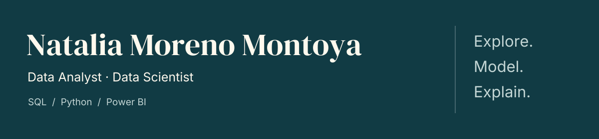

  <a href="https://www.linkedin.com/in/natalia-moreno-88a8b3268/"><b>LinkedIn</b></a>
  &nbsp; · &nbsp;
  <a href="mailto:natalia.moreno.mon@gmail.com"><b>Get in touch</b></a>

## About me

I am a **Data and Artificial Intelligence Engineering graduate** from Universidad Autónoma de Occidente, focused on **data analytics, business intelligence and predictive modeling**.

I enjoy making data useful: understanding a question, preparing reliable inputs, exploring patterns and explaining the results clearly. My experience in interpreting and teaching shapes how I communicate technical ideas to different audiences.

**Open to Data Analyst, BI Analyst and entry-level Data Scientist roles**, preferably remote, in Colombia or with international teams.

## What I do

- **Analyze & explain.** Clean and explore datasets, compare segments and build Power BI dashboards with clearly defined metrics.
- **Model & evaluate.** Develop classification, regression and computer vision projects; evaluate results and document assumptions, errors and limitations.
- **Connect & validate.** Integrate data from files, databases and APIs; build ETL workflows and check data quality before analysis.

## My stack

| Area | Tools I use |
| :--- | :--- |
| **Analytics & BI** | SQL · Python · pandas · NumPy · Power BI · Excel · Matplotlib · Seaborn |
| **Machine learning** | scikit-learn · CatBoost · PyTorch · YOLOv8n · ONNX Runtime Web |
| **Data & pipelines** | PostgreSQL · SQLite · Apache Airflow · Apache Kafka · PySpark · Great Expectations |
| **Development & deployment** | Git · Docker · Jupyter · Streamlit · Cloudflare Workers |

My data experience comes from **academic projects and technical assessments**, spanning tabular analytics, financial propensity models and computer vision applications.

## Beyond the technical work

**Communication and teaching** are part of my background: I currently work as an interpreter at Teleperformance and previously taught chess.

**Recognition:** third place at the AMCITECH 2026 Datathon and second place at Todos a Salvo: Desafío Occidente (2025), with my teams. I have also presented projects at TRIBU AI and DataDay.

**Languages:** Spanish — native · English — C1 · German — A1.

<b>Sobre mí · Español</b>

Soy ingeniera de Datos e Inteligencia Artificial, enfocada en **analítica, visualización y modelado predictivo**. Trabajo en proyectos que conectan la preparación de datos, el análisis, la evaluación de modelos y la comunicación de resultados.

Busco oportunidades como **Analista de Datos, Analista BI o Científica de Datos**, con preferencia por trabajo remoto. Aporto experiencia en interpretación y docencia para explicar información de forma clara y adaptarla a distintos públicos.

